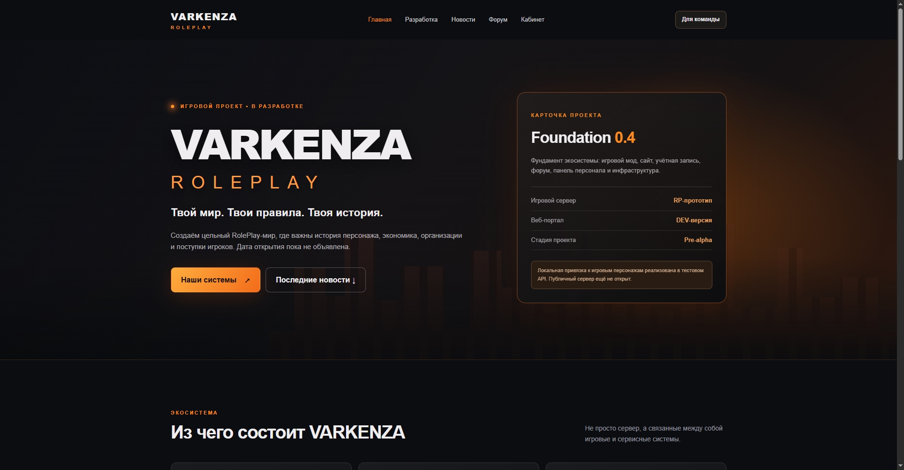
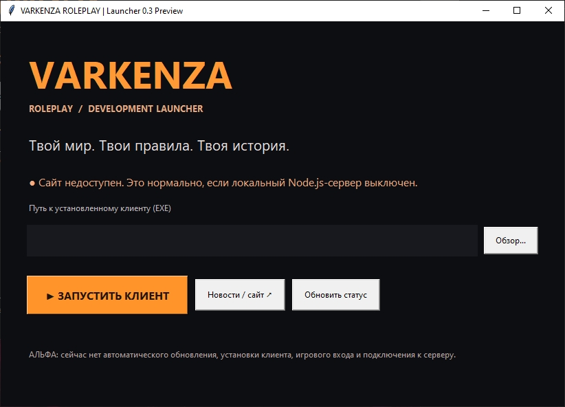
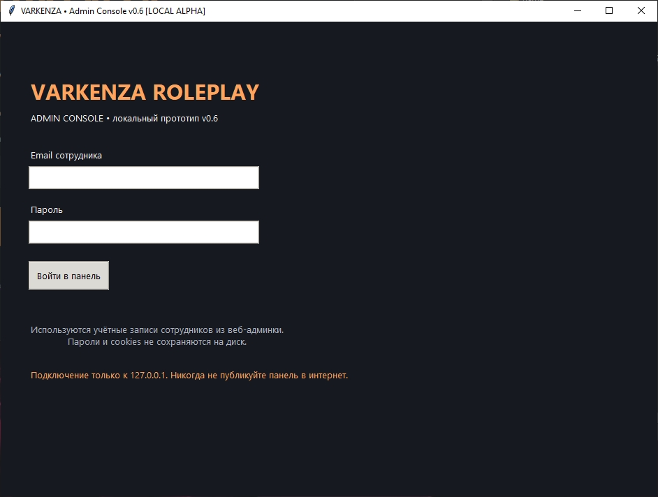
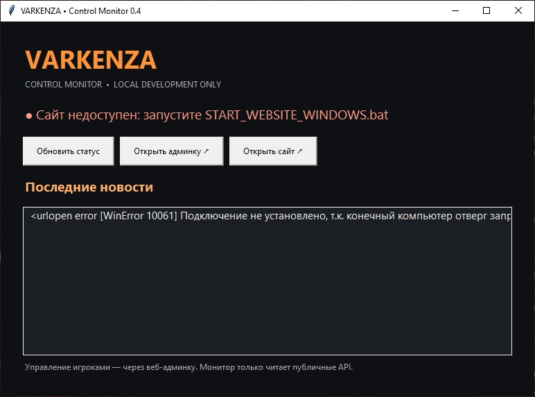

<div align="center">


# VARKENZA ROLEPLAY

**RolePlay-проект по GTA: San Andreas. Игровой мод, сайт, личный кабинет и инструменты администрации.**

Разработка ведётся открыто · Документация на русском языке

[](docs/ROADMAP.md)
[](https://github.com/Zeihos/VARKENZA-RolePlay/actions/workflows/core-check.yml)
[](https://github.com/Zeihos/VARKENZA-RolePlay/actions/workflows/openrp-integration.yml)
[](README.md)

**[Обзор](#о-проекте) · [Скриншоты](#интерфейсы) · [Установка](#как-запустить) · [Разработка](#текущий-статус) · [Участие](#участие-в-проекте)**

</div>

> [!IMPORTANT]
> **VARKENZA находится в технической альфе.** Это открытый репозиторий с исходниками и прототипами, **не готовый сервер для публичной игры**. Прохождение тестов сайта и подготовки игрового мода не подтверждает его компиляцию, совместимость с open.mp или работу с реальными игроками.

## О проекте

**VARKENZA ROLEPLAY** — самостоятельный RP-проект, объединяющий игровую часть, веб-сервисы и административные инструменты. В качестве исходной игровой базы выбран [open.RP](https://github.com/ZanderOperator/open.RP), подключённый как Git-подмодуль на зафиксированной ревизии. Этот мод исторически ориентирован на **SA-MP 0.3.DL и MySQL**.

Параллельно существует более ранний прототип VARKENZA на Pawn для open.mp и Node.js-система с SQLite. **Это две разные игровые основы**: они пока не объединены в одну работающую систему.

### Компоненты

| Часть проекта | Для чего нужна | Состояние |
| :--- | :--- | :--- |
| 🎮 **Игровая база** | open.RP, игровые системы и подготовка приватной сборки | Подключена; запуск и сборка дорабатываются |
| 🌐 **Сайт и кабинет** | Аккаунты, персонажи, экономические операции, разделы сайта | Локальный прототип |
| 💬 **Форум** | Темы, ответы и взаимодействие с сообществом | Прототип |
| 🛡️ **Администрирование** | Веб-панель, Windows-консоль и мониторинг | Прототипы |
| 🚀 **Лаунчер** | Локальный интерфейс запуска | Прототип |
| 🗃️ **Хранение данных** | SQLite у веб-прототипа; MySQL у open.RP | Требуется интеграция |

## Интерфейсы

Предварительные изображения уже созданных компонентов. Это **скриншоты прототипов**, не финальный дизайн релизной версии.

| Сайт | Лаунчер |
| :---: | :---: |
|  |  |
| **Админ-консоль** | **Мониторинг** |
|  |  |

Брендинг и материалы для публикаций находятся в [`assets/`](assets/).

## Как запустить

Для начала потребуется **Git** и соответствующая среда для нужного компонента.

**Получить исходники вместе с игровой основой:**

```bash
git clone --recurse-submodules https://github.com/Zeihos/VARKENZA-RolePlay.git
cd VARKENZA-RolePlay
```

**Запустить локальный сайт** (Node.js **22.13+**, Windows PowerShell):

```powershell
cd web
Copy-Item .env.example .env
# Замените заглушки секретов собственными значениями в .env
node --env-file=.env server.js
```

Локальный адрес: **http://127.0.0.1:3000**. Не публикуйте прототип напрямую в интернет.

**Подготовить основу open.RP:** потребуется Python 3, MySQL, Pawn-инструменты и собственные значения переменных `VARKENZA_MYSQL_PASSWORD` и `VARKENZA_RCON_PASSWORD`. Для Windows предусмотрен [скрипт сборки](tools/BUILD_OPENRP_WINDOWS.bat), но успешный запуск игрового сервера ещё не подтверждён.

Пошаговые инструкции, различия между двумя модами и проверка ошибок — в **[руководстве по запуску](docs/SETUP.md)**.

## Структура репозитория

```text
VARKENZA-RolePlay/
├── assets/            Фирменное оформление, публикации и превью
├── apps/              Админ-консоль, монитор и лаунчер
├── game/              Ранний самостоятельный Pawn-прототип
├── scripts/windows/   Команды запуска прототипов
├── tools/             Подготовка open.RP и тесты
├── upstream/open.RP/  Исходный мод open.RP (Git-подмодуль)
├── web/               Сайт, кабинет, форум и API
└── docs/              Русскоязычные инструкции и план работ
```

## Текущий статус

| Направление | Результат |
| :--- | :--- |
| Организация репозитория | ✅ Код и оформление приведены к понятной структуре |
| Автоматические проверки исходников | ✅ GitHub Actions настроен |
| Подготовка приватной копии open.RP | ✅ Базовый этап проверяется в CI |
| Компиляция игрового мода | 🔧 Идёт устранение зависимостей и ошибок Pawn |
| Подключение сайта к MySQL open.RP | 📋 Запланировано |
| Игровое тестирование и публичный релиз | ⏳ Не проведены |

**Что происходит сейчас:** [сборка игрового мода — задача #3](https://github.com/Zeihos/VARKENZA-RolePlay/issues/3), [интеграция сайта — задача #4](https://github.com/Zeihos/VARKENZA-RolePlay/issues/4). В [PR #5](https://github.com/Zeihos/VARKENZA-RolePlay/pull/5) ведётся работа над компиляцией; незавершённый код не выдаётся за релиз.

Подробная последовательность работ: **[Дорожная карта VARKENZA](docs/ROADMAP.md)**.

## Участие в проекте

Нашли ошибку, хотите предложить игровую механику или помочь с кодом? Откройте [Issues](https://github.com/Zeihos/VARKENZA-RolePlay/issues) по подходящему шаблону. Перед Pull Request прочитайте **[правила участия](CONTRIBUTING.md)**.

Если нашли уязвимость, **не публикуйте секреты и эксплойты в открытом Issue**. Порядок обращения описан в [политике безопасности](SECURITY.md).

## Авторы и лицензирование

Проект VARKENZA ROLEPLAY поддерживается **[Zeihos](https://github.com/Zeihos)**.

Игровая основа **open.RP** создана её первоначальными авторами и используется согласно **MIT License**. Условия сохранены в [OPENRP_LICENSE](OPENRP_LICENSE) и внутри [исходного подмодуля](upstream/open.RP). Это **не означает**, что у всех остальных компонентов репозитория автоматически такая же лицензия.

---

<div align="center">

**VARKENZA ROLEPLAY**

<sub>Разрабатываем постепенно. Проверяем изменения. Не называем альфу релизом.</sub>

</div>
