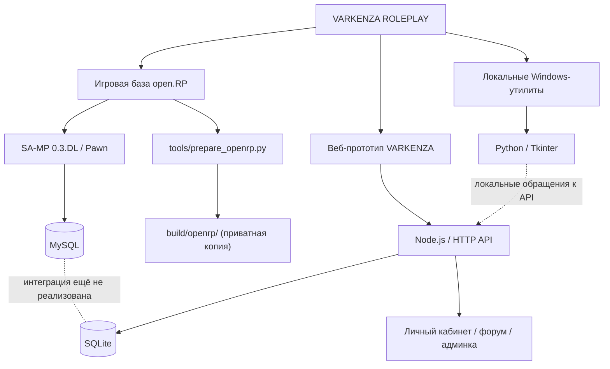

# Архитектура VARKENZA ROLEPLAY

**Текущий статус:** техническая альфа, компоненты ещё не объединены в единую игровую платформу.

[← На главную](../README.md) · [План разработки](ROADMAP.md) · [Как запустить](SETUP.md)

## Два направления разработки

> [!IMPORTANT]
> Пунктир между MySQL и SQLite обозначает **планируемую интеграцию, а не существующее подключение**. Две базы нельзя объединять простым переносом файлов. Банк, персонажи, гараж и права доступа должны получить единые серверные правила до публичного запуска.

## Роли каталогов

| Каталог | Назначение | Можно считать готовым к релизу? |
| --- | --- | --- |
| `upstream/open.RP/` | Код исходной игры, закреплённый Git-подмодуль с лицензией MIT | Нет — требуется адаптация, сборка и игровой тест |
| `tools/` | Подготовка и проверка отдельной рабочей копии open.RP | Частично — проверка подготовки проходит |
| `game/` | Старый самостоятельный Pawn-прототип VARKENZA | Нет — не является сборкой open.RP |
| `web/` | Локальный сайт, API, кабинет, форум, админка и SQLite | Прототип |
| `apps/` | Программы для Windows на Python/Tkinter | Прототип |
| `scripts/windows/` | Скрипты запуска прототипов | Для локальной разработки |
| `assets/` | Обложка, логотип, оформление, превью | Используется в GitHub и материалах |

## Как предполагается перейти к одной системе

1. **Собрать исходную игру.** Зафиксировать зависимости, компилировать Pawn и запустить SA-MP/open.mp в контролируемой среде. [Задача #3](https://github.com/Zeihos/VARKENZA-RolePlay/issues/3).
2. **Определить единую модель данных.** Учётная запись, персонаж, имущество, денежный баланс и права администратора должны иметь один авторитетный источник. [Задача #4](https://github.com/Zeihos/VARKENZA-RolePlay/issues/4).
3. **Интегрировать API с игровым сервером.** Предусмотреть проверку прав доступа и идемпотентные финансовые операции.
4. **Проверить сквозные сценарии.** Создание персонажа, вход в игру, изменение баланса, выход, просмотр данных на сайте.
5. **Подготовить релизную инфраструктуру.** Тесты безопасности, резервные копии, мониторинг, тестовый сервер и закрытая бета.

## Технические ограничения

- Старый `open.RP` рассчитан на SA-MP 0.3.DL и MySQL; его работоспособность на open.mp не доказана.
- Локальный сайт не следует напрямую публиковать в интернет.
- Ветка с исправлениями Pawn-сборки может иметь неуспешный CI; точное состояние проверяйте в [Actions](https://github.com/Zeihos/VARKENZA-RolePlay/actions) и [PR #5](https://github.com/Zeihos/VARKENZA-RolePlay/pull/5).
- Исходные файлы стороннего проекта остаются в подмодуле, сведения об авторах и MIT-лицензия сохраняются.

---

**VARKENZA ROLEPLAY** · Открытая разработка · [Сообщить об ошибке](https://github.com/Zeihos/VARKENZA-RolePlay/issues/new/choose)
